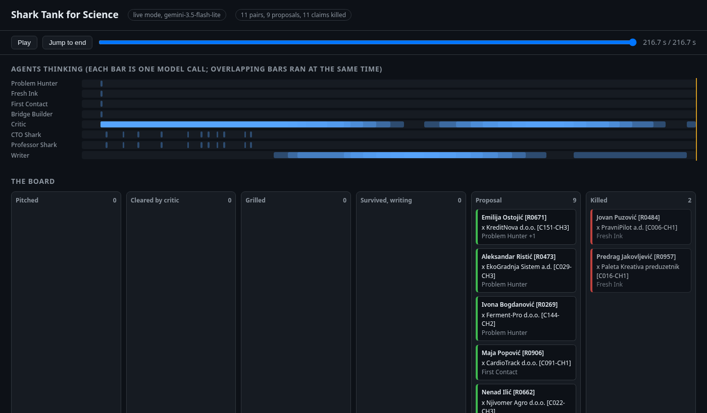
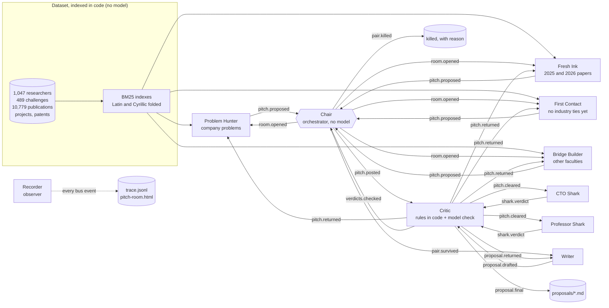

# Shark Tank for Science

Entry for the NTP Novi Sad AI Hackathon, **EINSTEIN track** (Science-to-Business Matchmaker). Built on [Mozaik](https://www.npmjs.com/package/@mozaik-ai/core) with Gemini.

**Live pitch rooms:** https://aarishmansur.github.io/shark-tank-for-science/ (the two recorded runs, playable in the browser, nothing to install)

[](https://aarishmansur.github.io/shark-tank-for-science/main-run.html)

The University of Novi Sad has over a thousand researchers and NTP Novi Sad has 150 companies, but they rarely work together. This project is a pitch room where agents find researcher and company pairs worth a joint project or an industrial PhD. A pair only becomes a proposal if it gets through the room:

1. **Four scouts** search the dataset at the same time, each with a different lens, and pitch the pairs they believe in.
2. **A critic** checks every claim in every pitch against the records it cites. Claims it cannot trace are killed and the pitch goes back to the scout once.
3. **Two sharks** grill each surviving pitch in parallel. The **CTO Shark** asks whether the company gets something usable within two years. The **Professor Shark** asks whether this is real research or consulting in disguise.
4. **The critic** checks the sharks too. An objection that is not in the records does not count.
5. **A writer** turns the pairs that survive into a proposal with research questions, a plan, what each side brings, and a risks and rebuttals section that answers the sharks. The critic reviews the draft and sends it back once if needed.

Every step, every model call and every kill goes into a JSONL trace, and a self-contained HTML page plays the run back.

## Demo
https://youtu.be/dMqInl7sK08https://youtu.be/dMqInl7sK08


## Results from the recorded run

The committed run (`recordings/main-run.json`, outputs in [`runs/recorded/main-run/`](runs/recorded/main-run/)) searched all 489 challenges from 153 companies against 1,047 researchers and 10,779 publications:

- 4 scouts pitched 11 pairs (one pair was found by two scouts and merged).
- The critic killed 11 claims: 3 by the hard rules in code (the scouts cited shortlist labels instead of records) and 8 by the model check (shark objections and writer claims the records do not support).
- The sharks killed 2 pairs with dealbreakers: a researcher with no capacity until mid 2026, and a company with no one to run what would be built.
- 9 proposals for 9 different pairs, for example [motion aware filtering for a patch ECG maker](runs/recorded/main-run/proposals/09-motion-aware-filtering-to-reduce-false-atrial-fibrillation-a.md), [feeder level PV forecasting for a grid analytics company](runs/recorded/main-run/proposals/08-industrial-phd-proposal-day-ahead-feeder-level-pv-forecastin.md) and [an LCA inventory for a building panel maker](runs/recorded/main-run/proposals/03-industrial-phd-proposal-life-cycle-assessment-inventory-and-.md).
- 68 model calls, 158k input and 39k output tokens on the Gemini free tier: $0.

Start with [`summary.md`](runs/recorded/main-run/summary.md) (board, every critic intervention, tokens per agent), then open `pitch-room.html` in a browser.

## Architecture



All participants join one Mozaik runtime and talk only through typed semantic events on the bus (`src/room/events.ts`). Nobody calls anybody directly. Agents are `createAgent` participants with situation handlers; the Chair and the Recorder are `createHuman` participants that never call a model. Each model call runs in its own Mozaik agent loop with a fresh context, so the four scouts, the two sharks and the critic really do think at the same time. The trace proves it: `bus.inference.started` and `bus.inference.completed` lines from different agents overlap, and the HTML page draws them as lanes.

| Participant | Kind | Job |
| --- | --- | --- |
| Problem Hunter | scout agent | Starts from each challenge and finds the closest researcher profile |
| Fresh Ink | scout agent | Starts from 2025 and 2026 papers and finds a company that needs them now |
| First Contact | scout agent | Only researchers with no industry experience on record who say they are open to it |
| Bridge Builder | scout agent | The best match from outside the faculty a company would normally call |
| Critic | agent | Kills unsupported claims in pitches, shark verdicts and proposals. Fails closed |
| CTO Shark | agent | Commercial value within two years, who on the company side owns it |
| Professor Shark | agent | Research depth, supervision capacity, publishable results |
| Writer | agent | Proposal with plan, IP terms, risks and rebuttals, first meeting agenda |
| Chair | human participant, no model | Board, duplicate merging, the decision rule, wildcards, closing the room |
| Recorder | human participant, no model | Writes every bus event to the trace |

### How the critic works

Two layers, both logged as `critic.kill` with the layer that fired:

1. **Rules in code** (`src/room/citations.ts`). A claim dies if it cites nothing, cites an id that does not exist, cites a record that belongs to neither this researcher nor this company, or quotes text that is not in the cited record. Ids mentioned in proposal prose are checked the same way. No model can overrule this layer.
2. **Model check.** The critic reads each surviving claim next to the full text of what it cites and decides if the text supports it. If the check itself fails (quota, bad output), every claim in it is killed: nothing is accepted on trust.

A pitch is cleared only if at least two claims survive and at least half of them do. Otherwise it goes back to its scout with the reasons, once. Killed shark objections do not count towards the decision. Claims killed in a proposal are stripped and listed at the bottom of the proposal file, so a reviewer sees what was removed and why.

### Measuring the critic

`npm run eval:critic` plants 22 false claims and mixes them with 16 hand labelled true ones ([`eval/critic-cases.json`](eval/critic-cases.json)), then runs both layers on them with the exact prompt the room uses. The false claims cover a paper by a different researcher, a paper by another researcher with the same name (the dataset has two Nina Mamužić and two Vladan Dobanovački), record ids that do not exist, a missing source, an invented quote, altered numbers (employees, farms, stations, MAPE target, substations, soil types) and wrong company or researcher facts (city, founding year, markets, crops, cloud provider, rank, patent subject, funder).

Real numbers from gemini-3.5-flash-lite, 3 runs ([`eval/critic-results.md`](eval/critic-results.md)):

| | Caught | False kills |
| --- | --- | --- |
| Rules + model, run 1 | 22/22 | 0/16 |
| Rules + model, run 2 | 22/22 | 0/16 |
| Rules + model, run 3 | 22/22 | 1/16 |
| Rules only, no model | 8/22 | 0/16 |
| Rules + the lexical stand-in used by `--mock` | 10/22 | 0/16 |

The rules alone catch every wrong-owner, same-name, missing-id and fake-quote claim. Everything about numbers and facts needs the model. The one false kill rejected "GridSense Analytics has 31 employees and is based at NTP Novi Sad" with a reason about a founding city the claim never mentioned, which is the kind of over-strictness to expect from a small model. Model answers are saved in `eval/critic-answers.json`, so the eval reruns without a key; with a key and a new model or prompt it calls Gemini again (4 calls per run).

This set is small and hand written, so it is easier than real pitches. In the recorded main run the critic made real false kills: before record excerpts were raised to 4,000 characters, it could not see a line late in a long company record (see "What doesn't work yet"). The longest record in the dataset is 3,668 characters, so the critic now always sees whole records.

### The decision rule (Chair, deterministic, unit tested)

- A dealbreaker objection that survived the critic kills the pair.
- Both sharks invest: the pair survives.
- One invests with confidence 7 or more and the other passes without a supported dealbreaker: the pair survives as a split decision.
- Anything else is killed, with the reason on the board.
- If fewer than 3 pairs make it, the strongest split decisions are promoted as clearly labelled **wildcards** so the run still yields the minimum number of proposals. Pairs killed by the critic or by a dealbreaker are never promoted.

### Reverse search

A company can describe a problem in its own words instead of picking from the challenge list:

```bash
npm run reverse -- "We run a mid-sized dairy. Our yoghurt and cheese lines lose product when milk quality changes from farm to farm..."
```

The text becomes a citable record (`Q-1`), every lens switches to its single problem mode, and the room runs as usual.

A recorded reverse search is in [`runs/recorded/reverse-run/`](runs/recorded/reverse-run/) (`npm run replay:reverse`). A dairy describes losing yoghurt and cheese batches to milk quality swings. Scouts pitched 6 researchers; the sharks killed 4 with dealbreakers (two people committed to other projects until the end of 2026, two whose work is on the farm side or on texture rather than intake prediction) and 2 became proposals. Saying no is part of the answer.

## How to run

Needs Node 20 or newer.

```bash
npm install
npm run data        # downloads the EINSTEIN dataset (32 MB) into data/
```

**Without a key:**

```bash
npm run replay      # replays the recorded live run, every answer from recordings/main-run.json
npm run replay:reverse   # replays the recorded reverse search run
npm run mock        # offline run with small deterministic stand-in answers, marked [MOCK]
npm test            # 29 tests, including two mock end to end runs on a small fixture
```

**With a key** (free Google AI Studio key from https://aistudio.google.com/apikey, no card):

```bash
cp .env.example .env    # put GEMINI_API_KEY=... in it
npm start               # live run over every challenge, about 70 model calls
npm run reverse -- "describe your problem"
npm start -- --sector agri --pitches 2
npm start -- --approve  # a person approves or rejects each pair before a proposal is written
```

Useful options: `--pitches N` per scout, `--sector <name>`, `--rpm` and `--concurrency` for the throttle, `--record <file>` to name the recording, `--resume <file>` to finish a run that hit a quota, `--speed 0` for an instant replay, `--approve` for the human approval gate (below). `MODEL` and `WRITER_MODEL` choose the Gemini models (both default to `gemini-3.5-flash-lite`).

Every run writes to `runs/<timestamp>-<mode>/`:

| File | What it is |
| --- | --- |
| `trace.jsonl` | One line per event: timestamp, ms since start, agent, pair, data. Model calls with tokens and latency, every critic kill with its layer, every status change |
| `summary.md` | The board, every critic intervention, tokens per agent |
| `proposals/*.md` | One file per proposal, every claim with its record ids |
| `pitch-room.html` | Self-contained playback: agent lanes, the board moving from pitched to proposal or killed, the room log. Click a card for its history |
| `board.json` | Full state of every pair |

### Free tier notes

The runner throttles all agents together (default 12 requests per minute, 4 in flight), retries 429 and 503 with the delay Gemini asks for, and never throws into the agent loops. On the free tier `gemini-3.5-flash` allows only 20 requests per day, so the room uses `flash-lite` by default and falls back to it if a bigger model is busy or out of quota. Live runs save the recording as they go, so a run that stops can be finished with `--resume`. The recorded run was finished this way: the first attempt used `flash` for the writer and hit the daily cap, so it was resumed with every scout and shark answer from the first attempt reused (marked `model.cached` in the trace) and the critic and writer calls redone.

## How this plugs into the EINSTEIN network and EINSTEIN Stars

EINSTEIN is a Horizon Europe project at the University of Novi Sad (grant 101136377, 2024 to 2028) with partners including DTU, Wageningen University and JKU Linz. EINSTEIN Stars is its competition that helps PhD students and young researchers turn research into industrial PhDs and market-ready projects: workshops, mentoring, contacts with industry and investors, and a final pitch to a jury at the Science and Technology Park Novi Sad.

The pitch room is built to feed that pipeline:

1. **Before each Stars call.** Run the room over the current NTP company challenges and UNS profiles. The output is a shortlist of concrete industrial PhD topics, each with a named company problem, a possible supervisor and the evidence. The Stars team sends them to the faculties as "topics with a company already interested", so applicants start from a real problem instead of a blank page.
2. **Coaching before the final pitch.** A Stars finalist describes their project in reverse search mode. The sharks ask the questions a jury will ask (who on the company side owns this, is it research or consulting, what is publishable), and the risks and rebuttals section becomes their preparation sheet.
3. **Across the network.** The Bridge Builder lens is aimed at what a network is for: matches from outside the faculty a company would normally call. Adding public profiles from partner universities (OpenAlex, CORDIS) would let it propose co-supervisors abroad, which suits the study visits that Stars already awards.
4. **For the NTP side.** Companies use reverse search as a front door: describe the problem, get two or three possible partners with the reasons and the open questions, and a first meeting agenda. People at EINSTEIN and NTP make the introduction; the system only prepares it.

Every proposal ends with the sharks' questions and the claims the critic removed, so the person who makes the introduction sees the weak spots first.

## Responsible data use

- **Only the provided synthetic dataset.** No scraping, no personal data from anywhere else. The test fixture in `tests/fixtures/data` is a small slice of the same synthetic data.
- **No ranking of people.** The system ranks pairs for a specific problem, never people by worth. Scores in the trace are BM25 text similarity and shark confidence in a pair. There is no researcher leaderboard and none can be produced from the outputs.
- **Every claim about a person cites a record** and is checked against it. Claims that fail are removed and listed, not silently dropped.
- **Availability is respected.** Profiles that say someone retired or left are excluded from the scouts' shortlists, and caveats such as limited capacity or a sabbatical are printed at the top of the proposal.
- **Profiles are not judged.** Thin profiles (no bio, keywords only) are pitched on what is there, and the First Contact lens exists to give researchers without industry ties a fair look.
- **A person decides.** Output is a proposal for a conversation, not a decision. The trace makes every step auditable.
- **Human approval gate.** With `--approve`, a Human reviewer joins the room as a Mozaik human participant. Every pair that survives the sharks stops before the Writer: the terminal shows the pair, the headline and the verdicts, and asks `y/n` plus an optional note. Only approved pairs get a proposal. A rejected pair is killed by the Human reviewer with the note as the reason, and it is never promoted as a wildcard. Each answer is written to the trace as a `human.decision` event, kept in the recording, and played back by `--replay`. The pitch room marks a pair waiting for a person and shows human yes or no on the card, and the proposal states that a person approved it. If the terminal closes, any open pair counts as rejected, so nothing is written without a yes.
- **Model data.** Only record text needed for a pair goes to Gemini. Do not run it on real personal data without the consent of the people in it and a provider agreement that fits.

## What doesn't work yet

- **The critic is a model and can be wrong both ways.** In the recorded run it rejected two shark objections about Ferment-Pro's staff that are in the company record: the critic was shown records cut at 2,600 characters and that detail sat past the cut. The limit is now 4,000, which covers every profile and company record in the dataset, but the recording keeps the old behaviour. The rules layer is exact; the model layer is not. `npm run eval:critic` measures it on hand labelled claims (see Measuring the critic): one false kill in 48 true claim checks, on an easier set than real pitches.
- **Light models only, on the free tier.** The recorded run uses `gemini-3.5-flash-lite` everywhere. Proposals are good but sometimes generic in the plan section; a stronger writer model would help and is one environment variable away.
- **Lexical search.** Shortlists come from BM25 over folded text, which misses synonyms across fields. Embeddings would find more surprising pairs, at a cost.
- **The company pages are not used.** `company-pages.jsonl` (websites, job ads, news) would sharpen the CTO Shark. Not done in time.
- **No live public sources.** OpenAlex and ORCID lookups are allowed by the rules but not implemented.
- **Duplicate people and shared names** are handled only by working with dataset ids throughout. The system does not merge two spellings of one person into one profile.
- **Mock mode is for structure, not quality.** Its answers are deterministic stand-ins so the pipeline and tests run offline.
- **One room at a time.** Mozaik's runtime is a process singleton, so each run is a separate process.

## Scoring criteria

| Criterion | Where to look |
| --- | --- |
| Multi-agent architecture and review loops (30) | 8 agents plus 2 non-model participants on one Mozaik bus, all event driven. Scouts and sharks run concurrently (overlapping lanes in `pitch-room.html`, asserted in `tests/e2e.test.ts`). Three review loops: critic to scout, critic to sharks, critic to writer, each with one retry. |
| Proposals (25) | 9 proposals for 9 different pairs in `runs/recorded/main-run/proposals/`, shaped after the dataset's industrial PhD example: problem, research questions, three phase plan, what each side brings, why this pair, risks and rebuttals, IP and publication terms, first meeting agenda. |
| Accuracy and transparency (20) | Every claim cites record ids. Two layer critic with every kill logged (`critic.kill` with layer and reason). Full JSONL trace with tokens and latency per call, replayable with no key. |
| Real use in EINSTEIN (15) | Reverse search for companies and Stars applicants, the four step plan above, availability caveats, wildcards clearly labelled. |
| Responsible data (10) | Synthetic data only, pairs not people, cite or die, fail closed, an optional human approval gate before any proposal, a person makes the introduction. |

## Project layout

```
src/
  main.ts            CLI: live, replay, mock, resume, reverse search
  runtime.ts         the Mozaik runtime for the room
  data/              dataset loading, text folding (Latin and Cyrillic), BM25, faculty names
  room/              events, state, lenses, evidence packs, citation rules, trace, run
  agents/            scout, critic, shark, writer, chair, recorder, human reviewer
  llm/               throttled runner (live, replay, mock), recording, ask helper
  report/            proposals, summary, terminal view, pitch room page
recordings/          recorded live runs for --replay
runs/recorded/       outputs of the recorded runs
eval/                critic eval cases, saved answers and results
tests/               node:test suites and a small fixture dataset
```

## License

MIT
